<!-- ═══════════════════════════════════════════════════════════════ -->
<!--                       PLAYER_01 // KOWSHIK                     -->
<!--                  NEON ARCADE PROFILE  •  v2.0.26               -->
<!-- ═══════════════════════════════════════════════════════════════ -->

  

  

  
  
  

  

<!-- ═══════════════ 01 · ABOUT ME ═══════════════ -->

  

<table>
  <tr>
    <td width="38%" align="center" valign="middle">
      
    </td>
    <td width="62%" valign="top">
      <h3>⚡ PLAYER_01 — RAMISETTY KOWSHIK</h3>
      
18-year-old <strong>AI &amp; ML engineer in training</strong>, studying at <strong>Amrita Vishwa Vidyapeetham, Chennai</strong> — and a front-end developer who treats every project like a new level to unlock.

      
I build <strong>interactive web experiences</strong>, wire them up to <strong>cloud backends</strong>, and sprinkle in <strong>generative AI</strong> wherever it makes the product smarter. Fast learner, vibe coder, Linux tinkerer.

      <ul>
        <li>🚀 <strong>MAIN QUEST</strong> — Artificial Intelligence, Generative AI &amp; Automation</li>
        <li>☁️ <strong>CLOUD BUILD</strong> — Google Cloud Platform, Firebase &amp; Cloud Firestore</li>
        <li>🛠️ <strong>SYSTEMS</strong> — Python, Bash/Shell, PowerShell, Linux &amp; Windows</li>
        <li>💻 <strong>FRONT-END</strong> — HTML5, CSS3, Flexbox, JavaScript &amp; WordPress</li>
        <li>⚡ <strong>SPECIAL SKILL</strong> — Vibe Coding: ship fast, iterate faster</li>
      </ul>
      

        
        
        
      

    </td>
  </tr>
</table>

  

<!-- ═══════════════ 02 · LIVE GAME FEED ═══════════════ -->

  

  

  <code>ARCADE MODE</code> — always mid-run: building, breaking, learning, repeating. Every commit is a new high score.

  

<!-- ═══════════════ 03 · TECH LOADOUT ═══════════════ -->

  

  

  

<!-- ═══════════════ 04 · GITHUB STATS ═══════════════ -->

  

  
  

  

  

  <code>CONTRIBUTION RUNNER</code> — auto-generated daily by <a href="./.github/workflows/snake.yml">snake.yml</a> 
  

  

<!-- ═══════════════ 05 · LEVEL SELECT ═══════════════ -->

  

  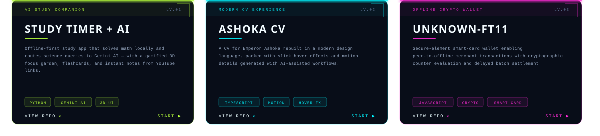

  
  
  

  

<!-- ═══════════════ 06 · QUEST LOG ═══════════════ -->

  

<table>
  <thead>
    <tr>
      <th align="left">⚔️ QUEST</th>
      <th align="left">🎯 OBJECTIVE</th>
      <th align="left">📊 STATUS</th>
    </tr>
  </thead>
  <tbody>
    <tr>
      <td><code>MAIN QUEST</code></td>
      <td>Build production-grade AI apps with Python &amp; Generative AI</td>
      <td></td>
    </tr>
    <tr>
      <td><code>SIDE QUEST</code></td>
      <td>Level up cloud skills on GCP, Firebase &amp; Firestore</td>
      <td></td>
    </tr>
    <tr>
      <td><code>DAILY GRIND</code></td>
      <td>Ship polished front-end builds &amp; deploy them</td>
      <td></td>
    </tr>
    <tr>
      <td><code>TRAINING</code></td>
      <td>Advanced DSA &amp; system design fundamentals</td>
      <td></td>
    </tr>
    <tr>
      <td><code>CO-OP</code></td>
      <td>Contribute to open-source projects</td>
      <td></td>
    </tr>
    <tr>
      <td><code>BOSS FIGHT</code></td>
      <td>Land an AI / ML internship and go all-in</td>
      <td></td>
    </tr>
  </tbody>
</table>

  

<!-- ═══════════════ 07 · CONNECT ═══════════════ -->

  

  
  
  

  Built with HTML, CSS, SVG + caffeine · artwork lives in <a href="./assets">/assets</a> · <code>PRESS ★ ON ANY REPO TO DROP A POWER-UP</code>

  

