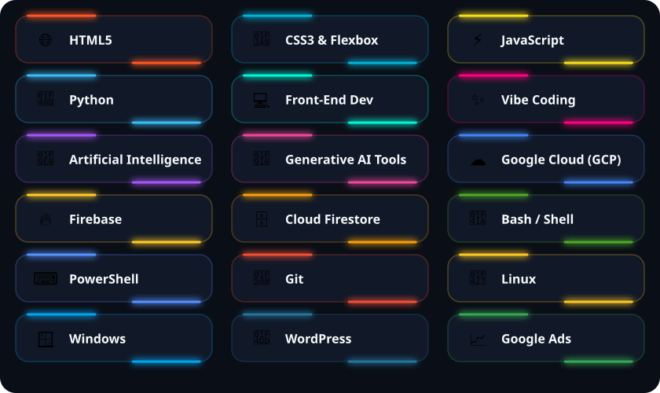

  

  

  

### ⚡ ABOUT ME

- 🚀 Exploring the future of **Artificial Intelligence, Generative AI & Automation**
- ☁️ Architecting cloud backends with **Google Cloud Platform (GCP), Firebase & Cloud Firestore**
- 🛠️ Scripting &amp; administering systems across **Python, Bash/Shell, PowerShell, Linux &amp; Windows**
- 💻 Crafting responsive interfaces with **HTML5, CSS3, Flexbox, JavaScript &amp; WordPress**
- ⚡ Building fast and shipping ideas through **Vibe Coding**

 

### 🛠️ MY TECH STACK

  

  

### 📊 GITHUB METRICS &amp; LIVE ACTIVITY

  
  

  

  

  

  

